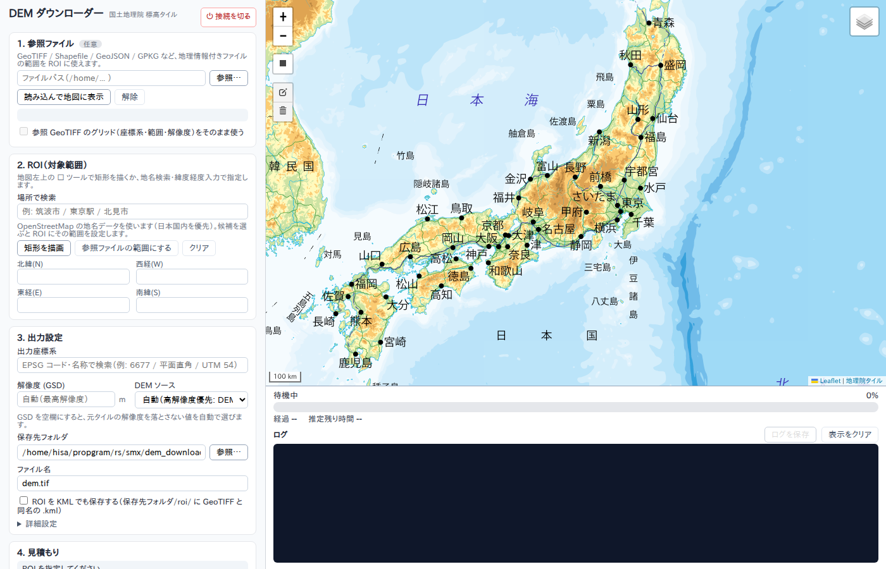

# DEM Downloader（国土地理院 DEM → GeoTIFF）

国土地理院の DEM タイル（第2・第3次など）を指定した矩形（ROI）で取得し、1 枚の GeoTIFF にモザイクする **ブラウザ GUI** です。  
SNAP の External DEM 向けに GeoTIFF メタデータ（`predictor=1` など）にも配慮しています。



## 主な機能

- Leaflet 地図上で ROI を矩形指定（ドラッグ・数値入力・参照ラスタの範囲取り込み）
- **地名検索**（OpenStreetMap / Nominatim 経由）で ROI を素早く設定
- 出力座標系の検索（JGD2011 / JGD2024 / 日本周辺 UTM 51N–56N など）
- タイル見積もり・並列ダウンロード・ログ・キャンセル
- 任意で ROI を **KML** として保存（`保存先/roi/*.kml`）
- ローカル専用（127.0.0.1）、完了後にサーバーを停止

## 必要環境

Conda（miniforge 推奨）:

```bash
cd dem_downloader
conda env create -f environment.yml
conda activate dem_downloader
```

依存: Python 3.12, Flask, rasterio, pyproj, fiona, shapely, numpy, requests

## 起動

```bash
conda activate dem_downloader
python run_dem_gui.py
```

既定は `http://127.0.0.1:8780`（使用中なら 8781… と自動で空きポートを探します）。

```bash
python run_dem_gui.py --port 9000 --no-browser
```

## ディレクトリ構成

| ファイル | 役割 |
|---------|------|
| `run_dem_gui.py` | Flask API・ジョブ管理・ブラウザ起動 |
| `dem_core.py` | タイル取得・モザイク・GeoTIFF 書き出し |
| `geo_io.py` | CRS プリセット、参照ファイル読み込み、KML、地名検索 |
| `static/` | フロントエンド |
| `run_dem_cli.py` | **CLI**（plant-isce3 エクスプローラ等から subprocess 呼び出し用） |
| `old/dem_downloader.py` | 以前の CLI 版（参考） |

## CLI（他ツールから呼ぶ）

`plant-isce3` 環境に `rasterio` を入れると依存が衝突しやすいため、国土地理院 DEM 取得だけ **この `dem_downloader` 環境**で行う運用を推奨します。

```bash
conda activate dem_downloader
python run_dem_cli.py \
  --west 130.6 --south 32.5 --east 130.9 --north 32.8 \
  --output /tmp/dem_ellipsoid.tif --mode auto --height-mode ellipsoid
```

`plant-isce3/workbench` は上記を自動で呼び出します（環境 `dem_downloader` または `DEM_DOWNLOADER_PYTHON`）。
| `tests/test_snap_profile.py` | SNAP 互換 GeoTIFF プロファイルの簡易チェック |

## テスト（任意）

```bash
conda activate dem_downloader
python tests/test_snap_profile.py
# または pytest が入っていれば: pytest tests/
```

## スクリーンショットの再取得

```bash
pip install playwright
playwright install chromium
python scripts/capture_readme_screenshot.py
```

## データ出典・注意

- DEM: [国土地理院 標高タイル](https://maps.gsi.go.jp/development/ichiran.html)
- 地名検索は Nominatim を利用します。過度な連続リクエストは避けてください。
