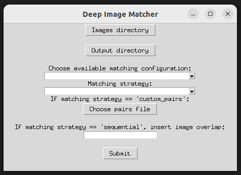

# kp_DIM — Deep Image Matching ローカル環境

[3DOM-FBK/deep-image-matching](https://github.com/3DOM-FBK/deep-image-matching)（DIM）をオフラインで触るためのディレクトリです。

- `deep-image-matching/` … 上流 DIM の作業ツリー（マルチビュー特徴点・マッチング → COLMAP / OpenMVG 等）
- `vendor/e2cnn/` … 必要に応じて同梱している依存（e2cnn）



（スクリーンショットは DIM 公式ドキュメントの GUI 画面です。詳細は上流 README を参照してください。）

## クイックスタート（概要）

インストール手順の正本は [DIM 公式ドキュメント](https://3dom-fbk.github.io/deep-image-matching/) です。おおまかな流れ:

```bash
cd kp_DIM/deep-image-matching
# 公式の installation.md に従い venv / CUDA / torch 等を準備
pip install -e .
```

Tk ランチャー（画像フォルダ・設定 YAML・マッチング戦略を選んで実行）:

```bash
cd kp_DIM/deep-image-matching
PYTHONPATH=src python -c "from deep_image_matching.gui import run_gui; run_gui()"
```

または CLI / `demo.py` からパイプラインを実行（`config/*.yaml`、サンプル画像は `assets/`）。

## このリポジトリに含めるもの

| 含む | 含まない（`.gitignore`） |
|------|-------------------------|
| ソース・設定・サンプル画像 | `assets/**/results_*`（再実行で生成される出力） |
| 同梱 thirdparty（学習済み重みなど） | ネストした `.git` ディレクトリ |

## サンプルデータ

`deep-image-matching/assets/example_*` に小規模データセットがあります。パイプラインの試行に利用できます。

## ライセンス

DIM 本体および `thirdparty/` 配下の各アルゴリズムは、それぞれ原作者のライセンスに従います。再配布・論文利用の際は上流の README と LICENSE を確認してください。

## 参考リンク

- 上流リポジトリ: https://github.com/3DOM-FBK/deep-image-matching  
- ドキュメント: https://3dom-fbk.github.io/deep-image-matching/
